<!-- generated by scripts/build.py — edit scripts/config.json instead -->

<!-- the wordmark is an image, not a <pre>: a <pre> of box-drawing characters is
     ~556px wide and forces a horizontal scrollbar on phones -->
<picture>
  <source media="(prefers-color-scheme: dark)" srcset="assets/hero-dark.svg">
  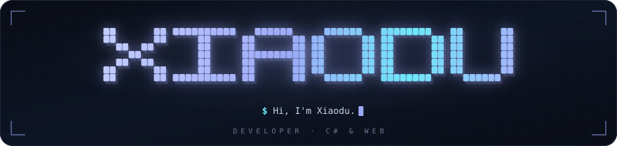
</picture>

  

 

  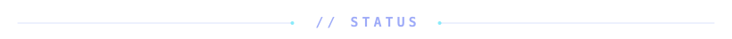
    
  <!-- one composed panel: heatmap + activity + streaks + languages -->
  <picture>
    <source media="(prefers-color-scheme: dark)" srcset="assets/status-dark.svg">
    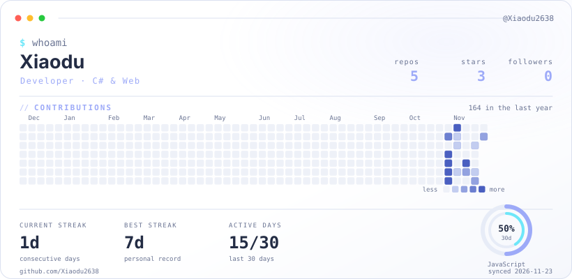
  </picture>

 

  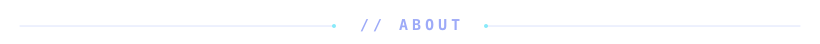
    

  <h2 align="center">Developer · C# & Web</h2>

  

    Hey, I'm Xiaodu — a developer who likes turning small ideas into things people can actually use. 
    I work mostly with C# / Avalonia for desktop tooling, and TypeScript / HTML / CSS for the web. 
    Right now I'm building offline-first tools and self-hosted services that keep working when the network doesn't.
  

  

    
  

   

  

    <a href="https://github.com/Xiaodu2638/Tarkov-Atlas">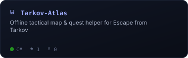</a>
<a href="https://github.com/Xiaodu2638/Live-QRCode">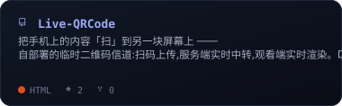</a> 
<a href="https://github.com/Xiaodu2638/Access-Denied">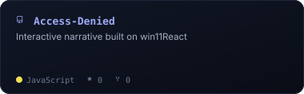</a>
  

 

  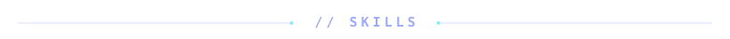
    
  <!-- icons + group headings are one image, rendered by scripts/build.py -->
  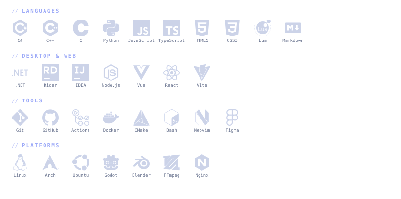
    
  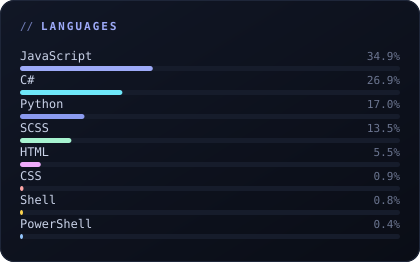

 

  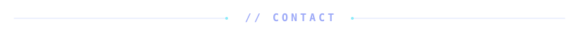
    
  
  

 

  

 

  README and every SVG on this page are generated from <code>scripts/config.json</code> — no third-party image hosts.

