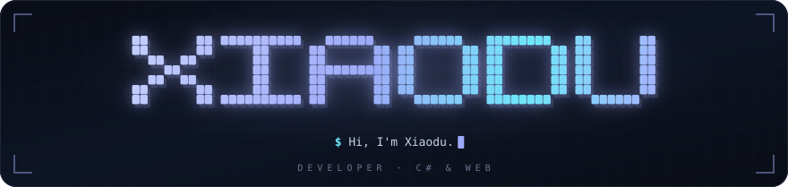
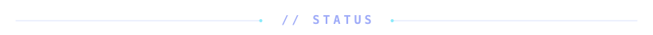
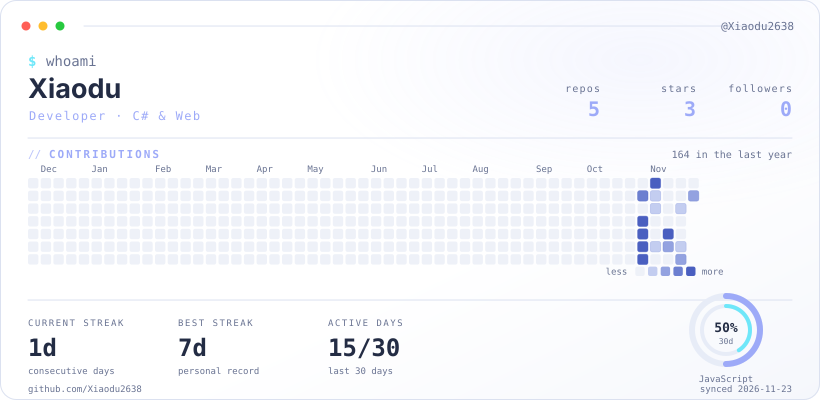
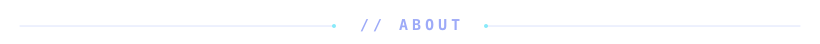
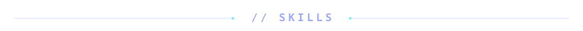
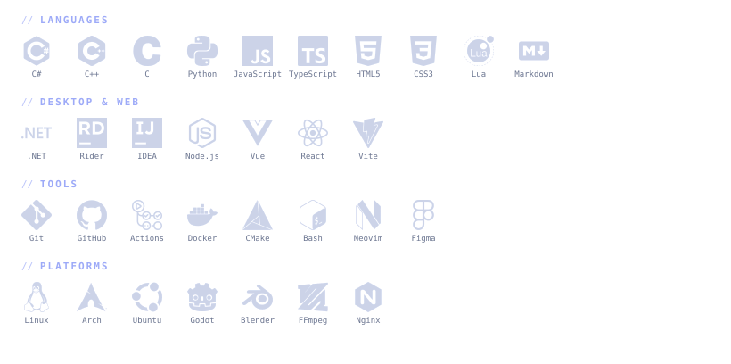
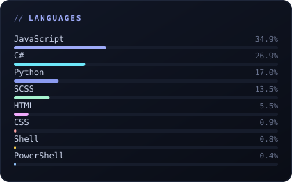
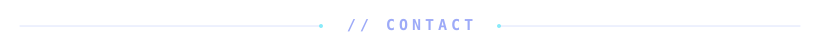

<!-- generated by scripts/build.py — edit scripts/config.json instead -->

<!-- the wordmark is an image, not a <pre>: a <pre> of box-drawing characters is
     ~556px wide and forces a horizontal scrollbar on phones -->
<picture>
  <source media="(prefers-color-scheme: dark)" srcset="assets/hero-dark.svg">
  
</picture>

  

 

  
    
  <!-- one composed panel: heatmap + activity + streaks + languages -->
  <picture>
    <source media="(prefers-color-scheme: dark)" srcset="assets/status-dark.svg">
    
  </picture>

 

  
    

  <h2 align="center">{{HEADLINE}}</h2>

  

    {{BIO}}
  

  

    {{BADGES}}
  

   

  

    {{PINNED}}
  

 

  
    
  <!-- icons + group headings are one image, rendered by scripts/build.py -->
  
    
  

 

  
    
  {{CONTACT}}

 

  

 

  README and every SVG on this page are generated from <code>scripts/config.json</code> — no third-party image hosts.

