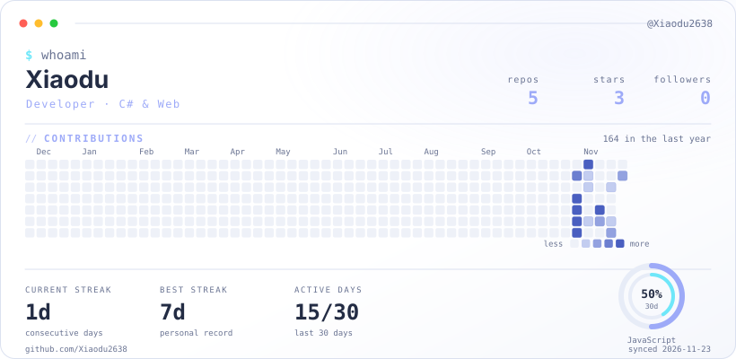

# Status panel

Generated by `scripts/build.py` so the panel can be previewed with GitHub's own
Markdown renderer before it goes on the profile page.

<picture>
  <source media="(prefers-color-scheme: dark)" srcset="../assets/status-dark.svg">
  
</picture>
